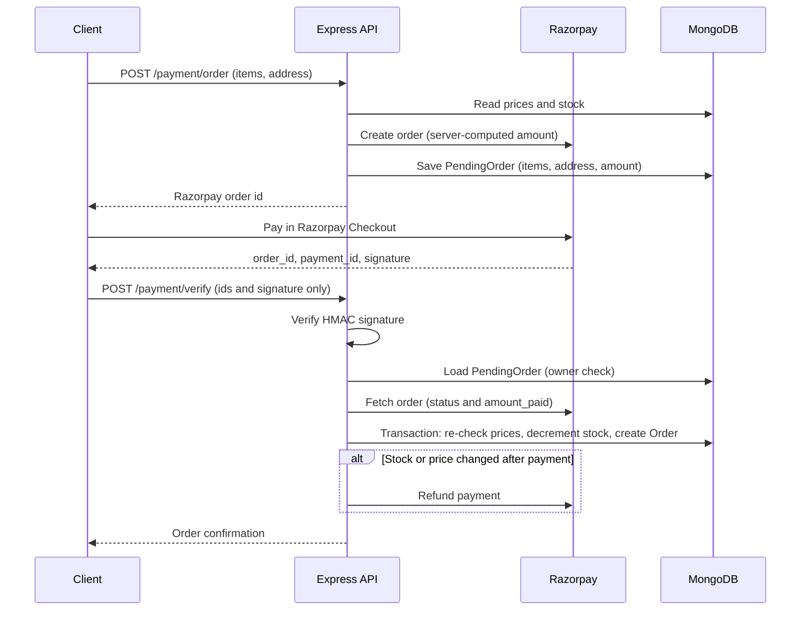

# BuyNest

BuyNest is a full-stack e-commerce application with a React storefront, an Express API, MongoDB persistence, Cloudinary product images, email verification, role-based administration, and Razorpay checkout.

## Features

- Browse products, view product details, and manage a client-side shopping cart.
- Register, verify an email address by OTP, log in, and view personal order history.
- Secure Razorpay checkout: the server prices the cart, stores what was priced, and verifies the signature **and** the paid amount before saving an order or deducting stock.
- Atomic stock updates inside MongoDB transactions, so concurrent checkouts cannot oversell a product.
- Idempotent payment verification (retries and double-clicks never create duplicate orders) and automatic refunds when a paid order cannot be fulfilled.
- Admin-only dashboard, product management, user directory, order list, and order-status updates.
- Upload product images to Cloudinary.
- Seed the database with sample users, products, and orders for development.
- Deploy the React build and API together on Vercel.

## Tech stack

| Area       | Technology                                         |
| ---------- | -------------------------------------------------- |
| Client     | React 19, Vite, React Router, Redux Toolkit, Axios |
| Server     | Node.js, Express 5, JWT, bcrypt                    |
| Database   | MongoDB with Mongoose                              |
| Services   | Cloudinary, Nodemailer (Gmail), Razorpay           |
| Deployment | Vercel serverless function and static hosting      |

## Project structure

```text
.
├── frontend/              # React/Vite client
│   ├── src/admin/         # Admin pages
│   ├── src/components/    # Shared UI and route guards
│   ├── src/config/api.js  # Environment-driven API URL helper
│   ├── src/context/       # Authentication context
│   ├── src/pages/         # Storefront pages
│   └── src/redux/         # Shopping-cart state
├── backend/               # Express API
│   ├── config/            # MongoDB and Cloudinary configuration
│   ├── controllers/       # Route handlers
│   ├── middleware/        # JWT, email, and admin guards
│   ├── models/            # User, Product, Order, and PendingOrder schemas
│   ├── routes/            # API routes
│   └── seed.js            # Development seed data
├── api/index.js           # Vercel serverless entry point
└── vercel.json            # Vercel build and rewrite rules
```

## Prerequisites

- Node.js 20 or later
- A MongoDB database (MongoDB Atlas or local MongoDB)
- Cloudinary account credentials for image uploads
- A Gmail account and app password for email OTPs
- Razorpay **test-mode** API keys for development

## Local setup

1. Install dependencies from the repository root:

    ```bash
    npm install
    ```

2. Copy the environment templates and fill in the values:

    ```bash
    cp backend/.env.example backend/.env
    cp frontend/.env.example frontend/.env
    ```

3. Start both applications:

    ```bash
    npm run dev
    ```

    The client runs at `http://localhost:5173` and the API runs at `http://localhost:5000` with its endpoints under `/api`.

4. Open `http://localhost:5173` in a browser.

Environment changes require restarting the corresponding development server.

## Environment variables

Create the two ignored files shown below. Do not commit `.env` files or expose server secrets in the frontend.

### `backend/.env`

```env
PORT=5000
MONGO_URI=mongodb_connection_string
JWT_SECRET=a_long_random_secret

EMAIL_USER=your_gmail_address
EMAIL_PASSWORD=your_gmail_app_password

CLOUDINARY_CLOUD_NAME=your_cloud_name
CLOUDINARY_API_KEY=your_api_key
CLOUDINARY_API_SECRET=your_api_secret

RAZORPAY_KEY_ID=rzp_test_xxxxxxxxxx
RAZORPAY_KEY_SECRET=your_razorpay_test_secret

FRONTEND_URL=http://localhost:5173
NODE_ENV=development
```

### `frontend/.env`

```env
VITE_RAZORPAY_KEY_ID=rzp_test_xxxxxxxxxx
VITE_API_URL=http://localhost:5000/api
```

Only variables beginning with `VITE_` are available in browser code. `VITE_RAZORPAY_KEY_ID` is a public Razorpay key; all other service secrets belong only in `backend/.env`.

## Scripts

Run these from the repository root unless noted otherwise.

| Command                                 | Purpose                                          |
| --------------------------------------- | ------------------------------------------------ |
| `npm run dev`                           | Start backend and frontend together              |
| `npm run dev:server`                    | Start the Express API with Nodemon               |
| `npm run dev:client`                    | Start the Vite development server                |
| `npm run build`                         | Create the frontend production build             |
| `npm run start`                         | Start the backend without Nodemon                |
| `npm run seed_data --workspace=backend` | Replace database data with development seed data |

> Warning: the seed command deletes all existing users, products, and orders before inserting sample data. Use it only with a development database.

## API overview

Protected endpoints require an `Authorization: Bearer <jwt>` header. Endpoints marked **Admin** require an authenticated user with the `admin` role.

| Method   | Endpoint                 | Access        | Description                                                                                                 |
| -------- | ------------------------ | ------------- | ----------------------------------------------------------------------------------------------------------- |
| `GET`    | `/health`                | Public        | API health response                                                                                         |
| `POST`   | `/api/auth/register`     | Public        | Create an account and send an email OTP                                                                     |
| `POST`   | `/api/auth/verify-email` | Public        | Verify an account with its OTP                                                                              |
| `POST`   | `/api/auth/login`        | Public        | Authenticate and receive a JWT                                                                              |
| `POST`   | `/api/auth/logout`       | Public        | End the client session                                                                                      |
| `GET`    | `/api/auth/users`        | Admin         | List users without password hashes                                                                          |
| `GET`    | `/api/products`          | Public        | List active products                                                                                        |
| `GET`    | `/api/products/:id`      | Public        | Get one product                                                                                             |
| `POST`   | `/api/products`          | Admin         | Create a product; accepts multipart `image`                                                                 |
| `PUT`    | `/api/products/:id`      | Admin         | Update a product; accepts multipart `image`                                                                 |
| `DELETE` | `/api/products/:id`      | Admin         | Delete a product                                                                                            |
| `GET`    | `/api/orders/myorders`   | Authenticated | Get the current user’s orders                                                                               |
| `GET`    | `/api/orders`            | Admin         | List all orders                                                                                             |
| `PUT`    | `/api/orders/:id/status` | Admin         | Update order status                                                                                         |
| `POST`   | `/api/payment/order`     | Authenticated | Price the cart and address on the server, create a Razorpay order, and save a `PendingOrder`                |
| `POST`   | `/api/payment/verify`    | Authenticated | Verify the signature and paid amount against the `PendingOrder`, then create the order (refunds on failure) |
| `GET`    | `/api/analytics/stats`   | Admin         | Get store totals                                                                                            |

## Payment flow and security

Checkout is designed so the browser is never trusted for prices, cart contents, or amounts.



How it protects the payment:

- **Server-side pricing.** Prices always come from the database. Totals are computed in integer paise to avoid floating-point mismatches.
- **No client-supplied cart at verification.** `/payment/verify` accepts only the three Razorpay identifiers. The cart, address, and amount come from the `PendingOrder` saved when the order was created, so a user cannot pay for a cheap cart and submit an expensive one.
- **Amount reconciliation.** Razorpay is asked for the real order state; the order must be `paid` and `amount_paid` must equal the amount the server priced.
- **Signature check.** The HMAC signature is compared with `crypto.timingSafeEqual`.
- **Ownership check.** A payment can only be verified by the user who created it.
- **Idempotency.** Repeated or simultaneous verify calls return the same order; a unique index on the payment id prevents duplicates.
- **Overselling protection.** Stock is decremented with a conditional atomic update inside a transaction (`stock >= quantity`).
- **Automatic refunds.** If stock, availability, or price changed between checkout and payment, the transaction is rolled back and the payment is refunded through Razorpay. If the refund itself fails, the error is logged for manual follow-up.
- **Cleanup.** `PendingOrder` records for abandoned checkouts expire after 7 days (TTL index).

## Payment testing

Use Razorpay **test-mode** keys while developing. BuyNest has no application-level payment bypass: every completed checkout uses a Razorpay test order, and the server verifies the payment signature and the paid amount against the saved `PendingOrder` before it creates an order or updates stock.

For a successful Razorpay test payment, use any card below with any future expiry date and any random CVV.

| Network    | Card number           | Card type | Card sub type |
| ---------- | --------------------- | --------- | ------------- |
| Visa       | `4100 2800 0000 1007` | Debit     | Consumer      |
| Mastercard | `5555 5100 0008 1006` | Credit    | Business      |
| Mastercard | `5180 2872 0009 1001` | Prepaid   | Consumer      |
| RuPay      | `6527 6589 0000 1005` | Credit    | Consumer      |
| Diners     | `3608 280009 1007`    | Credit    | Consumer      |
| Amex       | `3402 560004 01007`   | Credit    | Consumer      |

If Razorpay asks for a phone number, enter any random number and select **Skip OTP** when that option is displayed. These values are for Razorpay test checkout only. Never use test cards or test keys for live payments.

## Deployment on Vercel

`vercel.json` builds `frontend/`, serves its `dist` directory, and routes `/api/*` to `api/index.js`, which loads the Express app.

Set these Vercel environment variables before deploying:

- All backend variables from `backend/.env`, except `PORT` (Vercel manages the serverless runtime).
- `FRONTEND_URL` set to the deployed site origin, for example `https://your-project.vercel.app`.
- `VITE_RAZORPAY_KEY_ID` set to the Razorpay public key for the target environment.
- `VITE_API_URL=/api` so the deployed client calls the colocated serverless API.

For a separate frontend and backend deployment, set `VITE_API_URL` to the public backend URL plus `/api`, and set `FRONTEND_URL` to the exact public frontend origin.

## Security notes

- Keep MongoDB, JWT, email, Cloudinary secret, and Razorpay secret values private.
- Never trust prices, totals, or cart contents sent by the client; the server recomputes them from the database (see [Payment flow and security](#payment-flow-and-security)).
- Use Razorpay live keys only after the payment flow has been reviewed and the production domain is configured in Razorpay.
- Restrict `FRONTEND_URL` to the exact allowed browser origin to enforce CORS.
- Use a dedicated Gmail app password rather than an account password.
